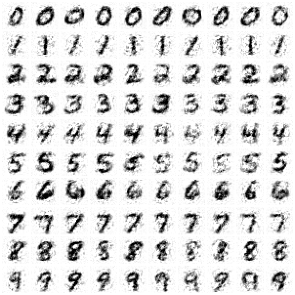

# diffusion-numpy

A denoising diffusion model (DDPM) written from scratch in NumPy and trained on
MNIST on a laptop CPU: the network, every gradient (checked against finite
differences), Adam, the noise schedule, DDPM and DDIM sampling, and
classifier-free guidance. No autograd and no deep-learning framework.



*100 generated digits, one row per class: 50-step DDIM, guidance weight 2,
stopped at t = 400 (see below). The model has 3.5M parameters and trained
for 20 minutes on an 8 GB MacBook.*

## How it works

- **Forward process.** x_t = √ᾱ_t·x₀ + √(1−ᾱ_t)·ε over T = 1000 steps with
  the cosine schedule (Nichol & Dhariwal 2021).
- **Network.** An MLP over the 784 pixels: time-step embedding (sinusoid →
  MLP) added inside three LayerNorm–SiLU residual blocks of width 512, plus
  a linear skip from input to output. Hand-written forward and backward for
  every layer (`src/diffusion/nn.py`); `python -m diffusion.gradcheck`
  checks them against finite differences in float64.
- **Target: v, not ε.** The network predicts v = √ᾱ·ε − √(1−ᾱ)·x₀
  (Salimans & Ho 2022). See below for why that mattered here.
- **Class conditioning** through a label embedding, dropped 10% of the time
  so one network also learns the unconditional model, which is what
  classifier-free guidance needs (Ho & Salimans 2022):
  out = out_uncond + w·(out_cond − out_uncond).
- **Training.** Batch 128, Adam at 1e-3 with warmup and cosine
  decay, gradient clipping, an EMA of the weights for sampling. 30,000 steps
  in 12–20 minutes, depending on what else the machine is doing. Checkpoints hold the RNG and optimizer state, so an
  interrupted run resumes bit-for-bit (tested).
- **Sampling.** Ancestral DDPM (1,000 network calls) or DDIM (Song et al.
  2021; 50 calls by default).

## Measuring the samples

There is no Inception network here, so a separately trained MNIST classifier
(also hand-written, 97.3% test accuracy) stands in for one. On 2,000 samples
per setting:

- **Conditional accuracy**: the classifier names the digit that was asked for.
- **Fréchet distance** between the classifier's features of samples and of
  real test images: the FID recipe on a small feature extractor. Lower is
  better; it's comparable within this project, not with published FIDs.

| | Fréchet ↓ | Conditional accuracy |
|---|---:|---:|
| Real training images (the floor at n = 2,000) | 78.6 | 98.0% (the classifier's own error) |
| Gaussian noise | 594.5 | — |
| ε-prediction model, guidance 3 | 251.6 | 24.4% |
| v-prediction, unconditional | 236.8 | — |
| v-prediction, conditional, no guidance | 177.2 | 79.4% |
| v-prediction, guidance 2 | 126.0 | 97.1% |
| v-prediction, guidance 2, stop at t = 400 | **110.4** | 98.6% |

Every number is in `results/*.json`, produced by `ddpm evaluate`.

### Guidance: fidelity against diversity

| Guidance w | 1 | 1.5 | 2 | 3 | 5 | 8 |
|---|---:|---:|---:|---:|---:|---:|
| Fréchet | 177.2 | 136.3 | **126.0** | 133.6 | 158.8 | 184.2 |
| Conditional accuracy | 79.4% | 93.1% | 97.1% | 99.3% | 99.9% | 99.9% |

Accuracy keeps climbing with w, but past w = 2 the samples converge on one
stereotyped way of writing each digit and drift away from real handwriting.


## What went wrong, and what fixed it

**1. Predicting ε gave blobs.** The first full model (ε-prediction, 30k
steps) produced shapeless blobs, and class labels barely changed them.
Noising real test digits and asking the model for x₀ showed why: at t = 950
its x₀ estimate was *worse than predicting the average digit* (MSE 0.81 vs
0.26), even though its ε predictions were good (MSE 0.03). Recovering x₀ from
ε divides by √ᾱ ≈ 0.08 there, which multiplies the error ~170×, and that is
the noise level where a digit's overall shape is decided. Retraining with
v-prediction, which gives x₀ = √ᾱ·x_t − √(1−ᾱ)·v with no division, brought
the 3,000-step x₀ error at t = 950 from 1.14 to 0.28, and conditional
accuracy at guidance 3 from 24% to 99%.

**2. The last sampling steps add speckle.** Watching the model's x₀ estimate
during sampling shows the digit clean by mid-trajectory and speckle appearing
in the final, lowest-noise steps, where this MLP's predictions are weakest:


So `--t-min` stops sampling early and returns the x₀ estimate at that step.
The Fréchet distance improves down to t = 400–500 and gets worse again by
t = 650, where the estimate is a blurry average:

| Stop at t | 0 | 100 | 200 | 300 | 400 | 500 | 650 |
|---|---:|---:|---:|---:|---:|---:|---:|
| Fréchet (w = 2) | 126.0 | 124.3 | 118.6 | 114.8 | 110.4 | 109.9 | 123.5 |

This is a workaround for a weak low-noise denoiser, not a property of
diffusion: a convolutional U-Net would be the real fix. The default sampler
is still the full one (`--t-min 0`); compare
[docs/samples-full.png](docs/samples-full.png).

Two smaller findings from the same process:

- **The input-to-output skip.** Without it, a width-512 MLP plateaued (loss
  0.43 at 3,000 steps against 0.16 for width 1024). The target is largely a
  linear function of x_t, and a 784-pixel linear map can't pass through
  512-wide hidden layers. With the skip, width 512 reached 0.20 in less than
  half the time of width 1024.
- **Samplers.** At guidance 3, 50-step DDIM (Fréchet 133.6, 7 s for 2,000
  samples) beat 1,000-step DDPM (168.6, 154 s). Ten DDIM steps already give
  146.3.

## Limitations

- **Unconditional samples are weak** (Fréchet 236.8, and see
  [docs/unconditional.png](docs/unconditional.png)): many are ambiguous
  between digits. Guidance is doing much of the work in the headline figure.
- An MLP sees pixels, not neighbourhoods; convolutions would help most at
  low noise, where problem 2 comes from.
- The Fréchet distance uses a 256-feature MNIST classifier; with n = 2,000
  even real images score 78.6, so differences of a few points are noise.

## Usage

```bash
uv run ddpm train --out runs/main                  # 30k steps, 12-20 min on a laptop CPU
uv run ddpm sample --model runs/main/model.npz --per-class --guidance 2 --t-min 400 --out samples.png
uv run ddpm sample --model runs/main/model.npz --digit 7 -n 20 --out sevens.png
uv run ddpm evaluate --model runs/main/model.npz --conditional --guidance 2 --baselines
uv run python scripts/make_figures.py runs/main/model.npz
```

MNIST is downloaded once and checked against its pinned SHA-256. NumPy is
the only dependency; PNGs are written with `zlib`.

## Development

```bash
uv run pytest                    # 15 tests, ~2 s
uv run python -m diffusion.gradcheck
```

Tests include the gradient check (two configurations, three seeds), samplers
recovering the image exactly from an oracle that knows the noise (for ε and
v), v-target round trips, the Fréchet distance against closed forms, the
PNG writer, and bit-identical resume after an interruption.

MIT licensed.
