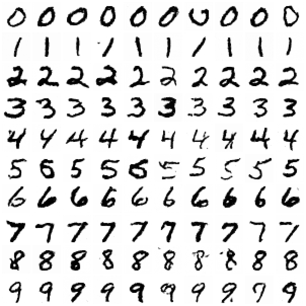
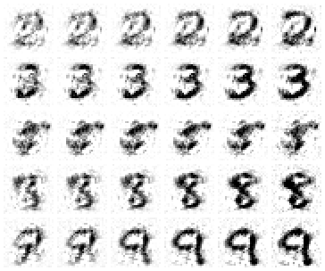
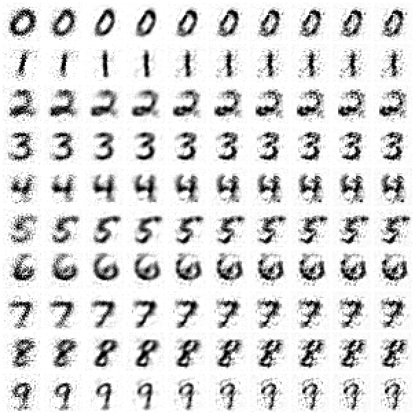
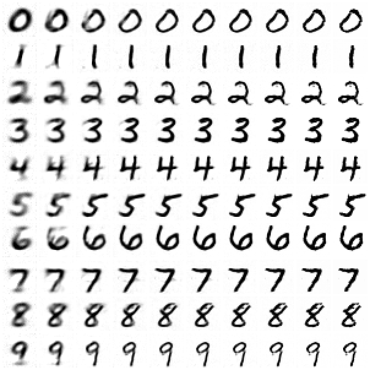

# diffusion-numpy

A denoising diffusion model (DDPM) written from scratch in NumPy and trained on
MNIST on a laptop CPU: the networks (an MLP and a convolutional U-Net), every
gradient (checked against finite differences), Adam, the noise schedule, DDPM
and DDIM sampling, and classifier-free guidance. No autograd and no
deep-learning framework.



*100 generated digits, one row per class: the U-Net (152k parameters, 88
minutes of training on an 8 GB MacBook), 50-step DDIM, guidance weight 2.
The first model, an MLP, needed tricks to get this far and still didn't;
see [MLP vs U-Net](#mlp-vs-u-net).*

## How it works

- **Forward process.** x_t = √ᾱ_t·x₀ + √(1−ᾱ_t)·ε over T = 1000 steps with
  the cosine schedule (Nichol & Dhariwal 2021).
- **Networks.** Two, with the same interface, so the samplers and
  evaluation are shared. An MLP over the 784 pixels (`src/diffusion/nn.py`):
  time-step embedding (sinusoid → MLP) added inside three LayerNorm–SiLU
  residual blocks of width 512, plus a linear skip from input to output; 4.1M
  parameters. And a U-Net (`src/diffusion/unet.py`, layers in `conv.py`):
  3×3 convolutions by im2col, GroupNorm, average pooling and nearest-neighbour
  upsampling over 28×28 → 14×14 → 7×7 and back, with skip connections and
  the time/class embedding projected into every block; 16 and 32 channels,
  152k parameters. Hand-written forward and backward for every layer;
  `python -m diffusion.gradcheck` checks both models against finite
  differences in float64.
- **Target: v, not ε.** The network predicts v = √ᾱ·ε − √(1−ᾱ)·x₀
  (Salimans & Ho 2022). See below for why that mattered here.
- **Class conditioning** through a label embedding, dropped 10% of the time
  so one network also learns the unconditional model, which is what
  classifier-free guidance needs (Ho & Salimans 2022):
  out = out_uncond + w·(out_cond − out_uncond).
- **Training.** Adam at 1e-3 with warmup and cosine decay, gradient
  clipping, an EMA of the weights for sampling. The MLP: batch 128, 30,000
  steps in 12–20 minutes, depending on what else the machine is doing. The
  U-Net: batch 32, 20,000 steps in 88 minutes. Checkpoints hold the RNG and
  optimizer state, so an interrupted run resumes bit-for-bit (tested).
- **Sampling.** Ancestral DDPM (1,000 network calls) or DDIM (Song et al.
  2021; 50 calls by default).

## Measuring the samples

There is no Inception network here, so a separately trained MNIST classifier
(also hand-written, 97.3% test accuracy) stands in for one. On 2,000 samples
per setting:

- **Conditional accuracy**: the classifier names the digit that was asked for.
- **Fréchet distance** between the classifier's features of samples and of
  2,000 real test images: the FID recipe on a small feature extractor. Lower
  is better; it's comparable within this project, not with published FIDs.

What real data scores sets the scale. An earlier version of this README
called the training-image score (78.6) the floor; it isn't. The classifier
was trained on those images (98.3% accuracy on them, 97.3% on test), so
their features are not typical, and the U-Net's samples later scored below
them. Held-out test images are the right reference, and two different
slices of 2,000 score 15.6 and 34.5, which also shows that gaps under ~20
points need care.

| MLP (v-prediction unless noted) | Fréchet ↓ | Conditional accuracy |
|---|---:|---:|
| Real test images, two other slices of 2,000 | 15.6, 34.5 | — |
| Real training images | 78.6 | 98.0% (the classifier's own error) |
| Gaussian noise | 594.5 | — |
| ε-prediction model, guidance 3 | 251.6 | 24.4% |
| Unconditional | 236.8 | — |
| Conditional, no guidance | 177.2 | 79.4% |
| Guidance 2 | 126.0 | 97.1% |
| Guidance 2, stop at t = 400 | **110.4** | 98.6% |

Every number is in `results/*.json`, produced by `ddpm evaluate`; the U-Net's
are `results/unet-*.json`.

### Guidance: fidelity against diversity

| Guidance w | 1 | 1.5 | 2 | 3 | 5 | 8 |
|---|---:|---:|---:|---:|---:|---:|
| Fréchet | 177.2 | 136.3 | **126.0** | 133.6 | 158.8 | 184.2 |
| Conditional accuracy | 79.4% | 93.1% | 97.1% | 99.3% | 99.9% | 99.9% |

Accuracy keeps climbing with w, but past w = 2 the samples converge on one
stereotyped way of writing each digit and drift away from real handwriting.



## What went wrong, and what fixed it

**1. Predicting ε gave blobs.** The first full model (ε-prediction, 30k
steps) produced shapeless blobs, and class labels barely changed them.
Noising real test digits and asking the model for x₀ showed why: at t = 950
its x₀ estimate was *worse than predicting the average digit* (MSE 0.81 vs
0.26), even though its ε predictions were good (MSE 0.03). Recovering x₀ from
ε divides by √ᾱ ≈ 0.08 there, which multiplies the error ~170×, and that is
the noise level where a digit's overall shape is decided. Retraining with
v-prediction, which gives x₀ = √ᾱ·x_t − √(1−ᾱ)·v with no division, brought
the 3,000-step x₀ error at t = 950 from 1.14 to 0.28, and conditional
accuracy at guidance 3 from 24% to 99%.

**2. The last sampling steps add speckle.** Watching the model's x₀ estimate
during sampling shows the digit clean by mid-trajectory and speckle appearing
in the final, lowest-noise steps, where this MLP's predictions are weakest:



So `--t-min` stops sampling early and returns the x₀ estimate at that step.
The Fréchet distance improves down to t = 400–500 and gets worse again by
t = 650, where the estimate is a blurry average:

| Stop at t | 0 | 100 | 200 | 300 | 400 | 500 | 650 |
|---|---:|---:|---:|---:|---:|---:|---:|
| Fréchet (w = 2) | 126.0 | 124.3 | 118.6 | 114.8 | 110.4 | 109.9 | 123.5 |

This is a workaround for a weak low-noise denoiser, not a property of
diffusion, and the U-Net below doesn't need it. The default sampler is still
the full one (`--t-min 0`); compare
[docs/samples-full.png](docs/samples-full.png).

Two smaller findings from the same process:

- **The input-to-output skip.** Without it, a width-512 MLP plateaued (loss
  0.43 at 3,000 steps against 0.16 for width 1024). The target is largely a
  linear function of x_t, and a 784-pixel linear map can't pass through
  512-wide hidden layers. With the skip, width 512 reached 0.20 in less than
  half the time of width 1024.
- **Samplers.** At guidance 3, 50-step DDIM (Fréchet 133.6, 7 s for 2,000
  samples) beat 1,000-step DDPM (168.6, 154 s). Ten DDIM steps already give
  146.3.

## MLP vs U-Net

The MLP's two problems above, speckle at low noise and weak unconditional
samples, both look like a network that sees pixels rather than
neighbourhoods. So the second model is a small convolutional U-Net, trained
and evaluated exactly like the MLP.

| | MLP | U-Net |
|---|---:|---:|
| Parameters | 4.12M | 152k |
| Training | 30k steps × 128 = 3.84M images | 20k steps × 32 = 640k images |
| Time per training step | 24–40 ms | 265 ms |
| Training time | 12–20 min | 88 min |
| 2,000 samples, guidance 2 | 11 s | 347 s |

The U-Net is 27× smaller and saw 6× fewer images, but each image costs far
more: a convolution in NumPy is an im2col copy plus a matrix multiply, with
no fused kernels. It was sized (16/32 channels, batch 32) to fit an 8 GB
machine that was swapping; the planned 32/64 channels ran at 1.3 s/step.

**Denoising error.** Real test digits noised to step t, then each model's
x₀ estimate (MSE; predicting the average digit scores 0.255):

| t | 10 | 50 | 100 | 200 | 400 | 600 | 800 | 950 |
|---|---:|---:|---:|---:|---:|---:|---:|---:|
| MLP | 0.0003 | 0.0026 | 0.0076 | 0.0224 | 0.0566 | 0.0924 | 0.1793 | 0.3042 |
| U-Net | 0.0001 | 0.0009 | 0.0026 | 0.0069 | 0.0206 | 0.0534 | 0.1531 | 0.2489 |

The U-Net is better at every t, by about 3× at low noise, where the MLP's
speckle came from.

**Samples** (2,000 per row, 50-step DDIM; Fréchet ↓ / conditional accuracy):

| | MLP | U-Net |
|---|---:|---:|
| Unconditional | 236.8 | **95.3** |
| Conditional, no guidance | 177.2 / 79.4% | **42.5** / 88.0% |
| Guidance 2 | 126.0 / 97.1% | 139.5 / 99.3% |
| Guidance 2, stop at t = 400 | 110.4 / 98.6% | 136.1 / 99.6% |
| Guidance 3 | 133.6 / 99.3% | 241.1 / 99.9% |
| Guidance 3, 10 DDIM steps | 146.3 / 99.4% | 281.9 / 99.9% |

What this shows:

- **Early stopping no longer helps.** For the U-Net at guidance 2, stopping
  at t = 0, 100, 200 and 400 gives 139.5, 139.1, 136.9 and 136.1, all within
  the noise, against the MLP's 126.0 → 110.4. The trajectory has no speckle
  to cut off:

  

- **Unconditional samples improved most** (236.8 → 95.3). Most are clear
  digits now, but some still aren't
  ([docs/unet-unconditional.png](docs/unet-unconditional.png)).
- **Guidance changed roles.** For the MLP, guidance 2 was the best Fréchet
  distance. For the U-Net, guidance only makes it worse (42.5 → 139.5 →
  241.1): the unguided model already matches the data, and guidance trades
  that diversity for a stereotyped digit. It still buys accuracy (88.0% →
  99.3%), so the headline figure uses w = 2, but if the goal is samples that
  look like the data, use the U-Net unguided.
- **No sign of copying.** A Fréchet distance below the training images'
  invites the question. For 200 unguided samples, the median distance to
  the nearest training image is 9.97 (pixel L2), against 8.61 for 200 test
  digits the model never saw: samples are not closer to the training set
  than new data is.
- **Ten DDIM steps hurt the U-Net more** (241.1 → 281.9 at guidance 3,
  against 133.6 → 146.3 for the MLP).

## Limitations

- **The comparison isn't equal-compute.** The U-Net trained 4–7× longer in
  wall-clock time on 6× fewer images; neither model was tuned beyond what's
  described here.
- **Sampling is slow**: the U-Net needs about 0.17 s per sample at 50 steps
  with guidance, 30× the MLP (and up to 0.3 s when the machine was
  swapping: identical runs took 347–616 s).
- The Fréchet distance uses a 256-feature MNIST classifier, and two slices
  of real test images differ by 19 points, so small gaps (such as the U-Net's
  early-stopping numbers) are not evidence either way.

## Usage

```bash
uv run ddpm train --out runs/main                  # MLP: 30k steps, 12-20 min on a laptop CPU
uv run ddpm train --arch unet --out runs/unet --steps 20000 --batch 32   # U-Net: ~90 min
uv run ddpm sample --model runs/unet/model.npz --per-class --guidance 2 --out samples.png
uv run ddpm sample --model runs/main/model.npz --per-class --guidance 2 --t-min 400 --out samples.png
uv run ddpm sample --model runs/main/model.npz --digit 7 -n 20 --out sevens.png
uv run ddpm evaluate --model runs/main/model.npz --conditional --guidance 2 --baselines
uv run python scripts/make_figures.py runs/main/model.npz
uv run python scripts/make_figures.py runs/unet/model.npz unet- 0
```

MNIST is downloaded once and checked against its pinned SHA-256. NumPy is
the only dependency; PNGs are written with `zlib`.

## Development

```bash
uv run pytest                    # 26 tests, ~7 s
uv run python -m diffusion.gradcheck
```

Tests include the gradient checks (both models, with and without classes,
three seeds each; every convolutional layer; Conv2d against a naive loop),
samplers
recovering the image exactly from an oracle that knows the noise (for ε and
v), v-target round trips, the Fréchet distance against closed forms, the
PNG writer, and bit-identical resume after an interruption for both models.

MIT licensed.
